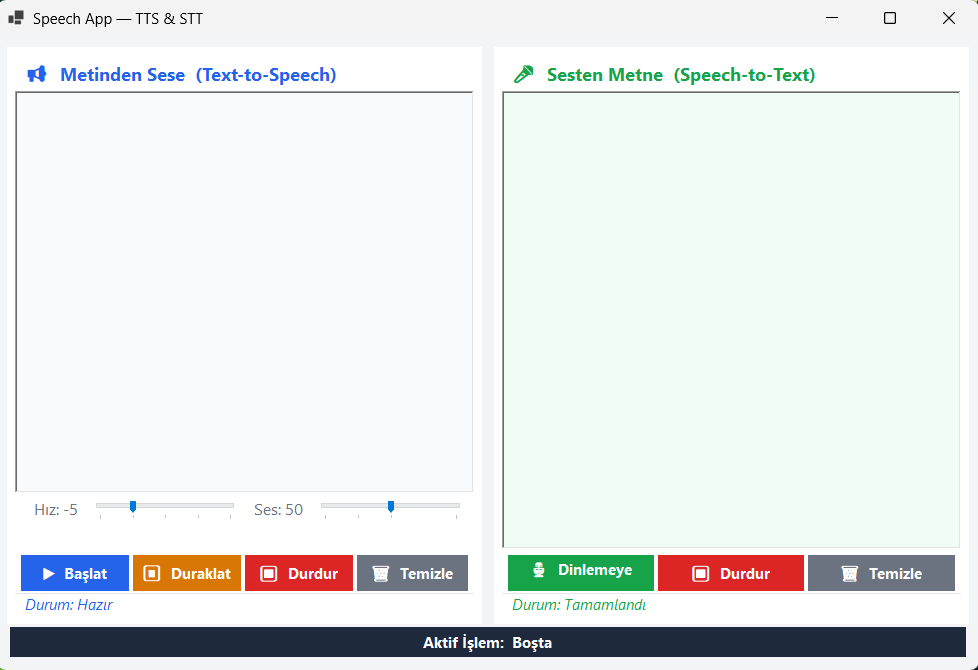

# 🎙 Speech App — TTS & STT

Ses ve metin arasında çift yönlü dönüşüm yapan bir **Windows Forms** uygulaması.  
Kullanıcı yazdığı metni sesli okutabilir; mikrofona konuşarak metni ekrana aktarabilir.

---

## 🛠 Kullanılan Teknoloji / NuGet Paketleri

| Teknoloji | Açıklama |
|---|---|
| **C# / .NET 10 (Windows)** | Hedef platform |
| **Windows Forms (WinForms)** | Grafik arayüz çerçevesi |
| **System.Speech 11.0.0** | TTS (SpeechSynthesizer) ve STT (SpeechRecognitionEngine) |

---

## ⚙ Kurulum ve Çalıştırma Adımları

### Gereksinimler
- Windows 10/11
- [.NET 10 Runtime](https://dotnet.microsoft.com/download/dotnet/10.0) (veya SDK)
- Mikrofon (Speech-to-Text için)

### Çalıştırma

```bash
# Depoyu klonla
git clone https://github.com/mustafahaccar18-art/SpeechApp.git
cd SpeechApp

# Derle ve çalıştır
dotnet run --project SpeechApp.csproj
```

Veya doğrudan çalıştırmak için:

```
bin\Release\net10.0-windows\SpeechApp.exe
```

---

## ✨ Uygulamanın Temel Özellikleri

### 📢 Metinden Sese (Text-to-Speech)
- `RichTextBox` içindeki metin sesli okunur
- **▶ Başlat** — seslendirmeyi başlatır
- **⏸ Duraklat / Devam Et** — seslendirmeyi duraklatır veya devam ettirir
- **⏹ Durdur** — seslendirmeyi iptal eder
- **🗑 Temizle** — metin alanını temizler
- **Hız** ve **Ses** kaydırıcıları ile okuma hızı ve ses seviyesi ayarlanabilir

### 🎤 Sesten Metne (Speech-to-Text)
- Mikrofon üzerinden alınan konuşma gerçek zamanlı olarak metin alanına aktarılır
- Sistemde kurulu olan en uygun konuşma tanıma motoru otomatik seçilir (önce Türkçe, sonra İngilizce)
- Mikrofon erişimi reddedildiğinde veya motor bulunamadığında kullanıcıya anlaşılır hata mesajı gösterilir

### 🖥 Arayüz
- Alt status bar'da **hangi işlemin aktif olduğu** her an görüntülenir
- Her iki panelde de anlık **durum etiketi** bulunur (Hazır / Çalışıyor / Hata vb.)

---

## 🖼 Ekran Görüntüleri

### TTS — Metin girişi ve çalışma ekranı


### Ayarlar (Hız & Ses kaydırıcıları)


---

## ⚠ Bilinen Sınırlamalar / Geliştirme Notları

- **Türkçe STT desteklenmiyor:** Windows'un yerleşik `System.Speech` API'si Türkçe konuşma tanıma motoru içermez. Uygulama bu durumda otomatik olarak İngilizce motora geçer.
- **Mikrofon izni:** Windows Gizlilik ayarlarından masaüstü uygulamalarına mikrofon erişimi verilmesi gerekir.  
  *Ayarlar → Gizlilik ve Güvenlik → Mikrofon → Masaüstü uygulamalarına izin ver → Açık*
- Gelecekte Azure Cognitive Services entegrasyonu ile Türkçe STT desteği eklenebilir.

---

## 👤 Öğrenci Bilgileri

| Alan | Bilgi |
|---|---|
| **Ad Soyad** | Mustafa Haccar |
| **Öğrenci No** | 18 |
