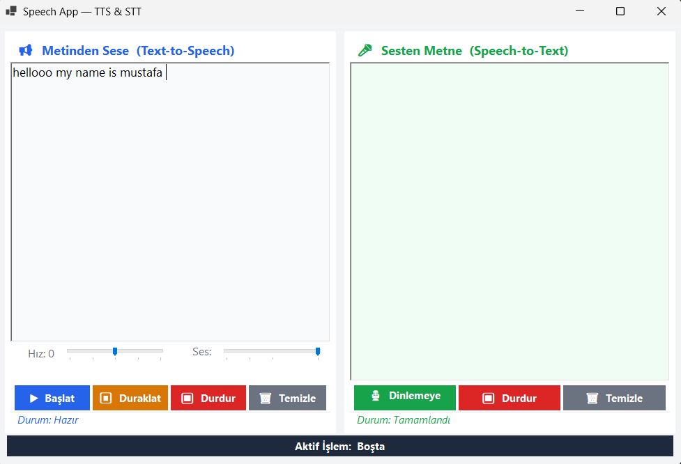

# 🎙 Speech App — TTS & STT

A bidirectional speech and text conversion desktop application developed with **Windows Forms (C# / .NET)**.  
Users can convert typed text to spoken audio (Text-to-Speech) and transcribe spoken input from a microphone to text in real time (Speech-to-Text).

---

## 🛠 Technologies & NuGet Packages

| Technology / Library | Description |
|---|---|
| **C# / .NET 10 (Windows)** | Target framework and runtime platform |
| **Windows Forms (WinForms)** | Graphical user interface framework |
| **System.Speech (v11.0.0)** | .NET Speech API providing `SpeechSynthesizer` (TTS) and `SpeechRecognitionEngine` (STT) |

---

## ⚙ Prerequisites, Installation & Running

### Prerequisites
- Windows 10 or Windows 11
- [.NET 10 SDK / Runtime](https://dotnet.microsoft.com/download/dotnet/10.0)
- Working microphone (required for Speech-to-Text)

### Building & Running from Source

```bash
# Clone the repository
git clone https://github.com/mustafahaccar18-art/SpeechApp.git
cd SpeechApp

# Restore packages, build and run
dotnet run --project SpeechApp.csproj
```

Alternatively, you can run the pre-built executable directly:

```
bin\Release\net10.0-windows\SpeechApp.exe
```

---

## ✨ Key Features

### 📢 Text-to-Speech (TTS)
- Reads text entered into the text editor (`RichTextBox`).
- **▶ Start (Başlat):** Asynchronously reads the text aloud.
- **⏸ Pause / Resume (Duraklat):** Pauses ongoing speech or resumes from where it was paused.
- **⏹ Stop (Durdur):** Immediately halts the speech synthesis.
- **🗑 Clear (Temizle):** Clears the text input field.
- **Speed & Volume Adjustments:** Dedicated sliders to control speech rate (`-10` to `+10`) and volume level (`0` to `100`).

### 🎤 Speech-to-Text (STT)
- Captures audio from the default input device (microphone) and transcribes recognized words into the output text field.
- **Automatic Recognizer Selection:** Automatically detects installed Windows speech recognition engines (falls back gracefully to English or other installed languages if Turkish is not present).
- **Error Handling & Feedback:** Provides descriptive error alerts if the microphone is disconnected, disabled, or if privacy permissions block access (`E_ACCESSDENIED`).
- **🎙 Start Listening, ⏹ Stop, 🗑 Clear:** Full control over speech recognition lifecycle.

### 🖥 User Interface & Status
- **Active Operation Bar:** Bottom status bar clearly indicates whether the app is idle, speaking (TTS), or actively listening (STT).
- **Responsive Layout:** Structured layout built with container panels and controls ensuring clean alignment across window resizes.

---

## 🖼 Screenshots

### Text-to-Speech (TTS) — Text Input & Controls


### Speed & Volume Sliders Adjustment


---

## ⚠️ Known Limitations & Development Notes

- **Windows Speech Recognition Language Support:**  
  Windows built-in `System.Speech` desktop API requires an installed desktop speech recognition engine. While Turkish TTS voices are standard on Windows, Turkish speech recognition engines are not bundled by default with `System.Speech`. The application automatically detects available language engines (such as `en-US`) and utilizes them.
- **Microphone Permissions:**  
  Windows Privacy Settings must grant desktop applications access to the microphone:  
  *Settings → Privacy & Security → Microphone → "Let desktop apps access your microphone" → ON*.
- **Future Improvements:**  
  Integration with cloud-based cognitive services (e.g., Azure Speech SDK or Google Cloud Speech-to-Text) could provide native multilingual recognition without relying on local Windows legacy speech engines.

---

## 👤 Student Information

| Field | Detail |
|---|---|
| **Full Name** | Mustafa Haccar |
| **Student ID** | 250541623 |
